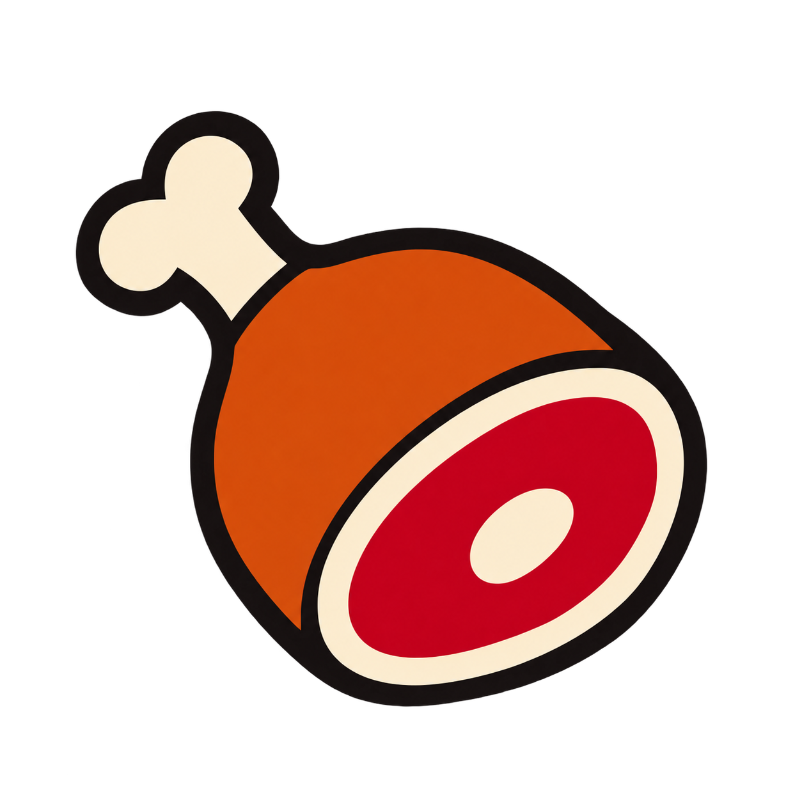

<div align="center">
  
  <h1>Meaty</h1>
  <p>Get to the meat of it.</p>
  <p>A local-first desktop app for recording conversations, cleaning up transcripts, and turning meetings into useful notes.</p>
  <p><a href="https://github.com/DonkeyKongII/Meaty">Source</a> · <a href="https://github.com/DonkeyKongII/Meaty/pulls">Pull requests</a> · <a href="docs/BUILDING.md">Build from source</a> · <a href="LICENSE.md">MIT license</a></p>
</div>

## What Meaty does

- **Record microphone and system audio** through a native Tauri desktop app.
- **Transcribe locally** with Whisper or Parakeet and display a provisional live transcript.
- **Clean up after the meeting** by re-reading the saved audio with silence-aware chunks and overlapping context where needed.
- **Summarize the cleaned transcript.** Both automatic and manual summary requests wait until the cleanup pass succeeds.
- **Identify speakers** with local post-recording analysis and explicitly enrolled voice profiles.
- **Organize meetings** with editable names, people and company assignments, transcript search, and speaker filters.
- **Start and stop recording from Google Meet** through an optional Chrome companion on macOS.
- **Choose a summary provider:** use local models or configure a supported cloud or OpenAI-compatible provider.

## Recording and cleanup

1. Select your microphone, system audio, and local transcription model in Settings.
2. Start recording manually, or configure the [Google Meet companion](integrations/chrome-google-meet/README.md).
3. Follow the live transcript while the meeting is in progress. Text may arrive after speech pauses; this transcript is provisional.
4. Stop recording. Meaty saves the recording and queues a full-audio cleanup pass that runs while the app is idle.
5. Generate a summary, or let automatic summary generation continue. Summary generation uses the committed, cleaned transcript.

Cleanup jobs survive an app restart. If cleanup fails, the live transcript and audio are kept, the summary stays on hold, and the meeting offers **Retry transcript cleanup**. A backup of the live transcript is kept alongside the cleaned transcript. The second pass can improve coverage, but it is not a guarantee of perfect transcription.

### Audio retention

Meaty saves audio during recording so the cleanup pass can recover speech missed live.

In **Settings → Recordings**, **Keep Audio After Processing** controls what happens afterward:

- **On:** retain the recording after processing.
- **Off:** delete the recording only after transcript cleanup and speaker analysis both succeed.

A failed processing step keeps the audio available for retry. This workflow applies to new recordings; existing saved meetings are not automatically reprocessed or deleted.

### Privacy

Recordings, local transcription, speaker analysis, and the meeting database are stored on your device. If you choose a cloud summary provider, the transcript and configured meeting context are sent to that provider. Optional integrations can also export meeting content when configured. Usage analytics is off by default. See the [privacy policy](PRIVACY_POLICY.md) for details.

## Installation

Meaty is currently developed and verified on Apple Silicon macOS. The repository also contains inherited Windows and Linux build configurations; those platforms need separate validation for the fork's newer features. The Google Meet companion described here is for macOS and Chrome.

Build from source using the [build guide](docs/BUILDING.md). Any packaged Meaty releases will be listed under [this fork's releases](https://github.com/DonkeyKongII/Meaty/releases). Installation instructions for this fork should use its own builds.

For a macOS app bundle, install **MEATY.app** in Applications and open it. Grant the microphone and system-audio permissions needed for the devices you select. Local models must be downloaded before first use.

## Development

Install Rust, Node.js, the platform's native build tools, and pnpm 9.15.9. On macOS, use full Xcode for native builds.

```sh
git clone https://github.com/DonkeyKongII/Meaty.git
cd Meaty/frontend
pnpm install --frozen-lockfile
pnpm run tauri:dev
```

Build a macOS application bundle:

```sh
pnpm exec tauri build --bundles app
```

The Cargo workspace writes build output under the repository's `target/` directory. The macOS bundle is `target/release/bundle/macos/MEATY.app`.

See also:

- [Build instructions](docs/BUILDING.md)
- [GPU acceleration](docs/GPU_ACCELERATION.md)
- [Architecture](docs/architecture.md)
- [Frontend development](frontend/README.md)
- [Speaker recognition](integrations/speakers/README.md)
- [Meeting context integration](integrations/meeting-context/WORKFLOW.md)
- [Contributing](CONTRIBUTING.md)

### Compatibility identifiers

The displayed product name is Meaty; the macOS bundle is **MEATY.app**. Some internal identifiers retain their original spelling to preserve existing data and integrations, including `com.meetily.ai`, the `meetily` executable and Cargo package, `meetily-recordings`, the Chrome native-messaging host, and CI artifact names. Use the exact identifiers shown in commands and paths. See the [architecture guide](docs/architecture.md#storage-and-compatibility) for storage locations.

## License and attribution

Meaty is an independently maintained fork of [Meetily](https://github.com/Zackriya-Solutions/meetily) by Zackriya Solutions, distributed under the [MIT license](LICENSE.md). The original copyright and license notices are preserved. Dependencies and model files retain their respective licenses.

Thanks also to the contributors and projects behind Whisper.cpp, Screenpipe, transcribe-rs, NVIDIA Parakeet, and its ONNX conversion by [istupakov](https://huggingface.co/istupakov/parakeet-tdt-0.6b-v3-onnx).
