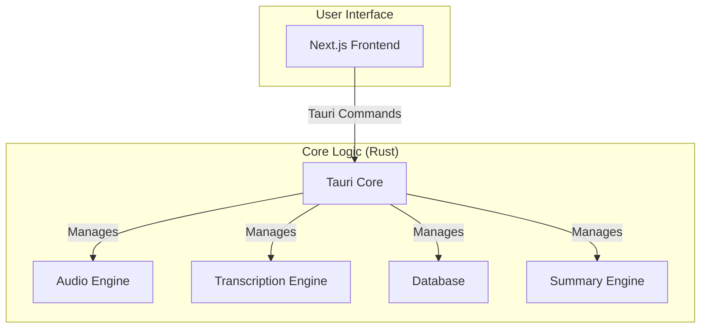

# System Architecture

Meaty is a self-contained desktop application built with [Tauri](https://tauri.app/). It combines a Rust-based backend with a Next.js frontend into a single, efficient, and cross-platform application.

## High-Level Architecture Diagram

## Component Details

### Frontend (Next.js)

*   Provides the user interface for managing meetings, displaying transcriptions, and configuring the application.
*   Communicates with the Rust core through Tauri's command system.

### Backend (Rust Core)

*   **Tauri Core:** The heart of the application, responsible for managing the window, handling events, and exposing the Rust core to the frontend.
*   **Audio Engine:** Captures audio from the microphone and system, processes it, and prepares it for transcription.
*   **Transcription Engine:** Uses local speech-to-text models (Whisper or Parakeet) to transcribe the captured audio. It can be accelerated with a GPU.
*   **Database:** A local SQLite database that stores meeting metadata, transcripts, and summaries.
*   **Summary Engine:** Generates meeting summaries using various Large Language Models (LLMs), including local models via Ollama.

## Recording-to-summary workflow

Meaty captures mixed microphone and system audio independently of the live speech detector. The live transcript provides provisional text during the meeting. When a recording is saved, the app queues a durable cleanup job in `transcript_cleanup_jobs`.

The cleanup pass re-reads the saved audio, detects speech with batch pause settings, splits long passages near quiet points, and uses overlapping context when needed. It removes exact repeated words at overlapping boundaries, keeps a live-transcript backup, and commits the cleaned transcript. If the transcript changes during processing, the pass stops before replacing those edits.

Both automatic and manual summaries wait for successful cleanup and reload the committed transcript afterward, including its timestamps. The existing context-preparation time limit cannot bypass this cleanup gate. Failures keep the live transcript and recording available and expose a retry action. Interrupted cleanup jobs return to the queue on restart; a new recording takes priority over batch processing.

The **Keep Audio After Processing** preference controls retention. Audio is captured temporarily even when retention is off. The app deletes its recording only after both cleanup and speaker analysis succeed; otherwise it keeps it for retry. Existing recordings are not retroactively queued or deleted by this workflow. Cleanup diagnostics support future chunk tuning; there is no automatic model training.

## Storage and compatibility

Meaty retains several legacy identifiers so existing installations continue to find their data and Chrome bridge:

- **Application identity:** `com.meetily.ai`.
- **macOS application data:** `~/Library/Application Support/com.meetily.ai/`, including `meeting_minutes.sqlite`, transcription models, and speaker profiles.
- **macOS recordings:** `~/Movies/meetily-recordings/`.
- **Custom templates:** the legacy directories listed in the [template guide](../frontend/src-tauri/templates/README.md).
- **Chrome native host:** `ai.meetily.meeting_autostart`, installed under `MeetilyMeetingBridge`.
- **Executable and Cargo package:** `meetily`; the macOS app bundle is `MEATY.app`.

These are exact technical names, not the displayed product branding. Renaming them requires a separate data and integration migration.
